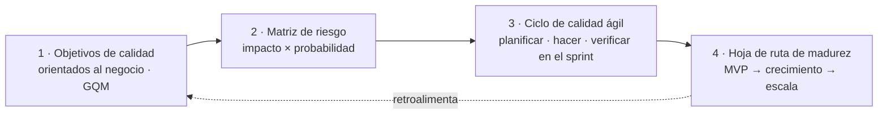

# Lean Quality Framework for Startups (LQF-S)

**La calidad como habilitador del crecimiento: un framework liviano que crece con la startup, construido a partir de un diagnóstico TMMi de startups tecnológicas chilenas.**

[English](README.md) · Español

---

## La pregunta

*¿Puede una startup incorporar prácticas de calidad desde el día uno sin sacrificar velocidad?*

Los modelos de calidad tradicionales son pesados para un equipo de cinco desarrolladores que corre hacia el product-market fit. Pero el costo de ignorar la calidad aparece justo cuando llega el crecimiento: usuarios perdidos, incidentes, deuda técnica y una historia más difícil frente a inversionistas. LQF-S nace para resolver esa tensión.

## Tres pilares

1. **Orientado al negocio y al riesgo.** La calidad es un medio para lograr objetivos de negocio: retención, conversión, cerrar una ronda. El trabajo de calidad se prioriza según su impacto en esos objetivos.
2. **Adaptativo.** Lo que necesita un MVP es muy distinto de lo que necesita una empresa con miles de usuarios. El framework crece con la startup.
3. **Liviano.** Las prácticas se integran al flujo Scrum o Kanban que el equipo ya usa, con la menor carga posible.

## Cuatro componentes

| Componente | Qué hace | Ejemplo |
|---|---|---|
| Objetivos de calidad orientados al negocio | Vincula métricas de calidad con una meta de negocio usando Goal-Question-Metric | Meta: +15% de retención el primer mes. Pregunta: ¿los bugs del onboarding hacen que los usuarios se vayan? Métrica: errores críticos reportados en las primeras 24 horas |
| Matriz de riesgo | Ubica las áreas del producto según impacto en el negocio y probabilidad de falla | Pagos y onboarding quedan en alto impacto / alta probabilidad y reciben el mayor esfuerzo de calidad |
| Ciclo de calidad ágil | Lleva criterios de calidad a la planificación, prácticas según riesgo al sprint y feedback real a la retro | Riesgo bajo: pruebas exploratorias del desarrollador. Riesgo alto: E2E automatizadas, seguridad básica, pruebas con usuarios |
| Hoja de ruta de madurez | Indica cuándo incorporar cada práctica | MVP: pruebas exploratorias y monitoreo de errores. Crecimiento: automatizar el happy path, revisión de código sistemática. Escala: pruebas de carga, CI/CD maduro, roles de calidad definidos |

Descripción completa (en inglés): [docs/framework.md](docs/framework.md).

## Qué encontró la investigación

Un diagnóstico basado en TMMi de **10 startups tecnológicas chilenas** (70% de quienes respondieron en cargos de gerencia o C-level; 70% con equipos de cinco desarrolladores o menos):

- **La madurez general está entre los niveles 2 y 3 de TMMi** en el 70% de las startups: hay procesos, pero no están estandarizados.
- **Medición y mejora son las áreas más débiles** (los niveles 4 y 5 promedian 2,8 de 5). Las decisiones se apoyan más en la intuición que en datos.
- **La gestión de defectos es el área más fuerte** (4,1), seguida de la planificación de pruebas.
- **La calidad es mayormente reactiva:** el 50% se enfoca en detectar errores; el 30% trabaja en prevención sistemática.

Detalle, datos por etapa y el mapeo de cada brecha a un componente del framework (en inglés): [docs/research-summary.md](docs/research-summary.md). Hay un resumen diseñado en [samples/](samples/).

## Contenido

| Ruta | Qué es |
|---|---|
| [docs/framework.md](docs/framework.md) | Los cuatro componentes en detalle, con plantillas |
| [docs/research-summary.md](docs/research-summary.md) | Método, resultados por etapa y mapeo de brechas a componentes |
| [templates/gqm-canvas.md](templates/gqm-canvas.md) | Canvas Goal-Question-Metric con ejemplos |
| [templates/risk-matrix.md](templates/risk-matrix.md) | Matriz de riesgo y cómo aplicarla en una hora |
| [samples/](samples/) | Resumen del assessment de madurez QA (PDF) |

## Origen

Actividad de grado del Magíster en Tecnologías de la Información y Gestión, Pontificia Universidad Católica de Chile (2025): *"Fortalecer las prácticas de calidad de software en startups tecnológicas chilenas, a partir del diseño de un modelo de servicio"*. Los resultados son agregados; no se identifica a ninguna empresa.

Contenido compartido bajo [CC BY-NC-ND 4.0](LICENSE).

---

Carla Achury · Calidad y Gobierno de IA · Santiago, Chile · [ckachury.github.io](https://ckachury.github.io)
