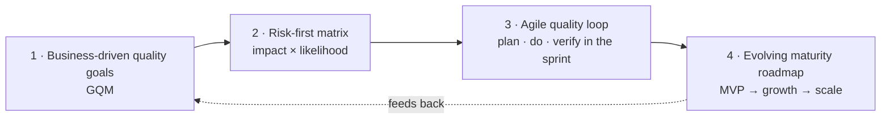

# Lean Quality Framework for Startups (LQF-S)

**Quality as a growth enabler: a lightweight framework that grows with the startup, built from a TMMi diagnosis of Chilean tech startups.**

English · [Español](README.es.md)

---

## The question

*Can a startup build quality practices from day one without giving up speed?*

Traditional quality models are heavy for a team of five developers racing to product-market fit. Yet the cost of ignoring quality shows up exactly when growth arrives: lost users, incidents, technical debt and a harder fundraising story. LQF-S was designed to resolve that tension.

## Three pillars

1. **Business and risk driven.** Quality is a means to business goals: retention, conversion, closing a round. Quality work is prioritised by its impact on those goals.
2. **Adaptive.** What an MVP needs is very different from what a company with thousands of users needs. The framework grows with the startup.
3. **Lightweight.** Practices fit into the Scrum or Kanban flow the team already uses, with minimal overhead.

## Four components

| Component | What it does | Example |
|---|---|---|
| Business-driven quality goals | Links quality metrics to a business goal with Goal-Question-Metric | Goal: +15% first-month retention. Question: are onboarding bugs driving users away? Metric: critical errors reported in the first 24 hours |
| Risk-first matrix | Maps product areas by business impact and likelihood of failure | Payments and onboarding land in high impact / high likelihood and get the most quality effort |
| Agile quality loop | Puts quality criteria into planning, risk-based practices into the sprint and real-world feedback into the retro | Low risk: developer exploratory testing. High risk: automated end-to-end, basic security, user testing |
| Evolving maturity roadmap | Tells the startup when to add which practice | MVP: exploratory testing and error monitoring. Growth: automate the happy path, systematic code review. Scale: load testing, mature CI/CD, defined quality roles |

Full description: [docs/framework.md](docs/framework.md).

## What the research found

A TMMi-based diagnosis of **10 Chilean tech startups** (70% of respondents in management or C-level roles; 70% with teams of five developers or fewer):

- **Overall maturity sits between TMMi levels 2 and 3** for 70% of startups: processes exist but are not standardised.
- **Measurement and improvement are the weakest areas** (levels 4 and 5 average 2.8 out of 5). Decisions rely on intuition more than data.
- **Defect management is the strongest area** (4.1), followed by test planning.
- **Quality is mostly reactive:** 50% focus on catching errors; 30% work on systematic prevention.

Details, data by growth stage and the mapping from each gap to a framework component: [docs/research-summary.md](docs/research-summary.md). A designed summary is in [samples/](samples/).

## Contents

| Path | What it is |
|---|---|
| [docs/framework.md](docs/framework.md) | The four components in detail, with templates |
| [docs/research-summary.md](docs/research-summary.md) | Method, results by stage and gap-to-component mapping |
| [templates/gqm-canvas.md](templates/gqm-canvas.md) | Goal-Question-Metric canvas with worked examples |
| [templates/risk-matrix.md](templates/risk-matrix.md) | Risk-first matrix and how to run it in one hour |
| [samples/](samples/) | QA maturity assessment summary (PDF) |

## Origin

Graduation project of the Master in Information Technology and Management, Pontificia Universidad Católica de Chile (2025): *"Strengthening software quality practices in Chilean tech startups through the design of a service model."* Results are aggregated; no company is identified.

Content is shared under [CC BY-NC-ND 4.0](LICENSE).

---

Carla Achury · Quality & AI Governance · Santiago, Chile · [ckachury.github.io](https://ckachury.github.io)
